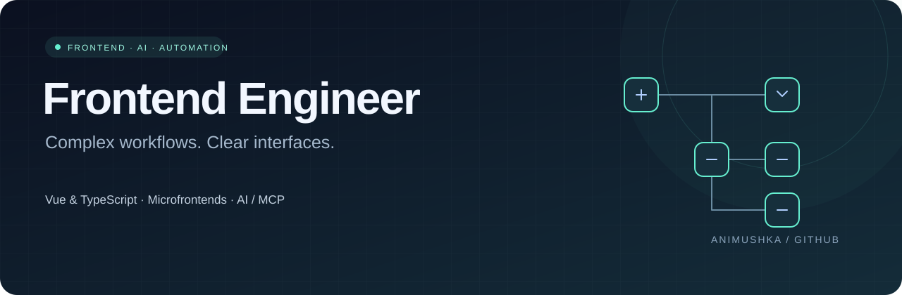

  

  <a href="https://github.com/Animushka?tab=repositories">Repositories</a> ·
  <a href="README.md">Русский</a>

# Frontend · AI · Automation

Web interfaces, visual editors, microfrontends and AI integrations. Main stack: **Vue 3 and TypeScript**, alongside React and Node.js.

### Focus

- **Visual editors:** drag-and-drop, parameter forms, connection validation and data workflows.
- **AI interfaces:** assistants, chats, LLM integrations and RAG.
- **MCP services:** UI generation, component templates and runtime contracts.
- **Architecture:** shared components, FSD, microfrontends and frontend/backend contracts.

### Stack

| Area | Technologies |
| :--- | :--- |
| Frontend | Vue 3, TypeScript, JavaScript, React, HTML, CSS |
| UI & editors | Quasar, Vuetify, Vue Flow, Three.js |
| Architecture | FSD, Single-SPA, Module Federation, monorepos |
| APIs & backend | Node.js, Fastify, REST / OpenAPI, WebSocket, OAuth 2.0 |
| AI | MCP, LLM integrations, RAG, structured output |
| Delivery & quality | Vite, Webpack, Docker, GitLab CI/CD, Vitest, Playwright |

Also used in projects: **Python, Rust and SQLite** for bots, automation and small services.

### Selected public projects

| Project | Overview |
| :--- | :--- |
| [Napominalochka](https://github.com/Animushka/napominalochka) | Telegram reminder bot and Mini App with recurring reminders, time zones, RU/EN and Yandex Alice integration. **Rust · React · TypeScript · SQLite**. [Try the bot ↗](https://t.me/napominalozhka_bot) |
| [Account Manager](https://github.com/Animushka/account-manager) | Account management UI with LDAP / Local record types, validation and browser persistence. **Vue 3 · TypeScript · Pinia · Vuetify** |
| [Microfrontend Demo](https://github.com/Animushka/market-single-spa) | Root configuration composing separate [login](https://github.com/Animushka/market-login) and [navigation](https://github.com/Animushka/market-nav) applications. **Single-SPA · TypeScript · Webpack** |
| [Three.js Scene](https://github.com/Animushka/car-three.js) | A small browser 3D experiment with a car moving around a circular track. **Three.js · JavaScript · Vite** |

Napominalochka builds on ExtremelyNaggyBot; upstream history and attribution are preserved in the repository.
