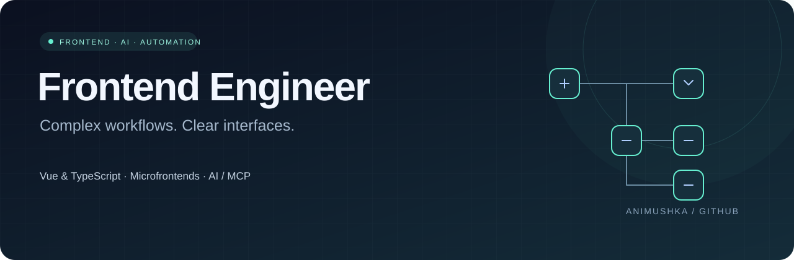

  

  <a href="https://github.com/Animushka?tab=repositories">Репозитории</a> ·
  <a href="README.en.md">English</a>

# Frontend · AI · Automation

Веб-интерфейсы, визуальные редакторы, микрофронтенды и AI-интеграции. Основной стек — **Vue 3 и TypeScript**, а также React и Node.js.

### Фокус

- **Визуальные редакторы:** drag-and-drop, формы параметров, проверка связей и работа с данными.
- **AI-интерфейсы:** ассистенты, чаты, LLM-интеграции и RAG.
- **MCP-сервисы:** генерация интерфейсов, компонентные шаблоны и runtime-контракты.
- **Архитектура:** общие компоненты, FSD, микрофронтенды и frontend/backend-контракты.

### Технологии

| Направление | Инструменты |
| :--- | :--- |
| Frontend | Vue 3, TypeScript, JavaScript, React, HTML, CSS |
| UI и редакторы | Quasar, Vuetify, Vue Flow, Three.js |
| Архитектура | FSD, Single-SPA, Module Federation, monorepo |
| API и backend | Node.js, Fastify, REST / OpenAPI, WebSocket, OAuth 2.0 |
| AI | MCP, LLM-интеграции, RAG, structured output |
| Разработка и поставка | Vite, Webpack, Docker, GitLab CI/CD, Vitest, Playwright |

Также в проектах: **Python, Rust и SQLite** — боты, автоматизация и небольшие сервисы.

### Проекты, которые можно посмотреть

| Проект | Что внутри |
| :--- | :--- |
| [🔔 Напоминалочка](https://github.com/Animushka/napominalochka) | Telegram-бот и Mini App: повторяющиеся напоминания, часовые пояса, RU/EN, интеграция с Алисой. **Rust · React · TypeScript · SQLite**. [Открыть бота ↗](https://t.me/napominalozhka_bot) |
| [🗂 Account Manager](https://github.com/Animushka/account-manager) | Интерфейс управления записями: типы LDAP / Local, валидация и сохранение состояния в браузере. **Vue 3 · TypeScript · Pinia · Vuetify** |
| [🧩 Microfrontend Demo](https://github.com/Animushka/market-single-spa) | Пример композиции приложений: [авторизация](https://github.com/Animushka/market-login), [навигация](https://github.com/Animushka/market-nav) и root-config. **Single-SPA · TypeScript · Webpack** |
| [🏎 Three.js Scene](https://github.com/Animushka/car-three.js) | Небольшой эксперимент с браузерной 3D-графикой: машинка движется по кругу. **Three.js · JavaScript · Vite** |

Напоминалочка развивается на основе ExtremelyNaggyBot; история и авторство исходного проекта сохранены в репозитории.
